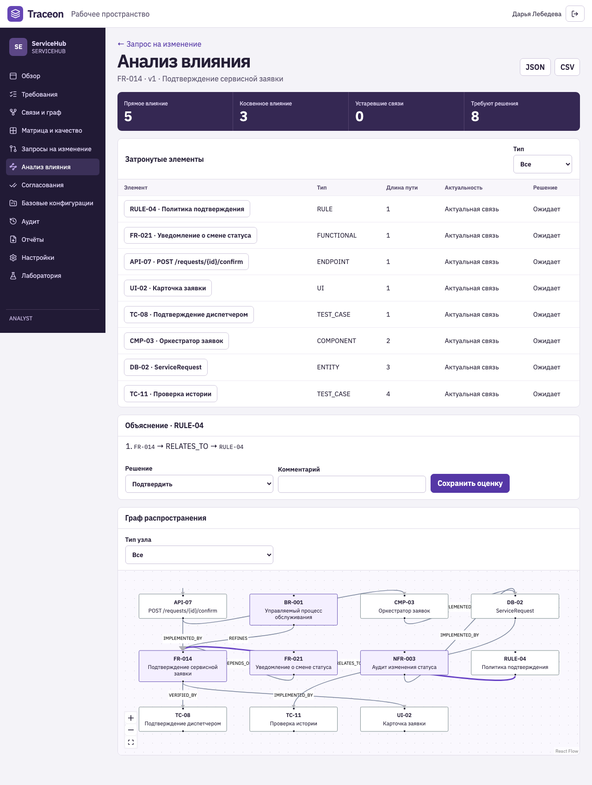

# Traceon

Управление требованиями, трассируемость и объяснимый анализ влияния.
Requirements engineering, traceability and explainable change impact.

**[Русский](README.ru.md) · [English](README.en.md)**

```sh
docker compose up --build
```

[Локальный стенд / Local workspace](http://127.0.0.1:8100) · [Architecture](docs/architecture/model.md) · [Test results](docs/testing/results.md)


